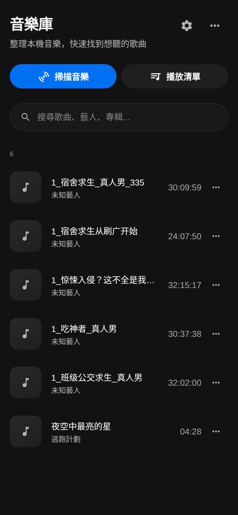
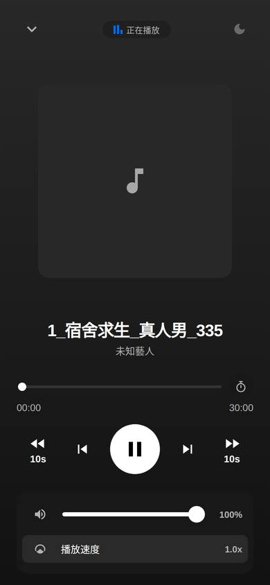
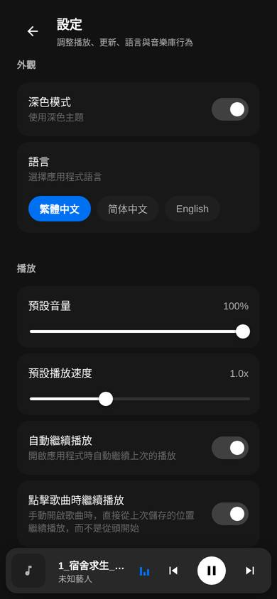

<p align="center">
  
</p>

<h1 align="center">Pulse</h1>

<p align="center">A local-first music player for Android, built with Tauri 2.<br>
Your music, playlists and progress stay on your device. No account. No cloud.</p>

<p align="center">
  &nbsp;&nbsp;
  &nbsp;&nbsp;
  
</p>

## Features

- Plays MP3, FLAC, WAV, AAC, OGG and M4A from your device
- Remembers where you stopped, per track
- Folder scan and manual import
- Playlists with duplicate protection
- Sleep timer, playback speed and skip controls
- English, 繁體中文， 简体中文

## Download

Get the latest APK from [Releases](https://github.com/sky1218-labs/pulse-tauri/releases) — most phones install `pulse-android-arm64-v8a.apk` (older 32-bit phones: `pulse-android-armeabi-v7a.apk`). Releases are signed with the project's release key, so updates install in place.

## Quick start

```bash
git clone https://github.com/sky1218-labs/pulse-tauri.git
cd pulse-tauri
npm ci
npm run dev
```

| Command | What it does |
| --- | --- |
| `npm run dev` | Run the UI in a browser |
| `npm test` | Run unit tests |
| `npm run build` | Production build |
| `npm run tauri dev` | Run the full app (needs Rust) |

Android packages are built by GitHub Actions on every `v*` tag.

## Known limitations

- Background/lock-screen media controls are now native (in-repo `tauri-plugin-mediasession`: foreground service + media notification) — pending confirmation on a real device; background playback survival still depends on the device WebView not being killed
- Data is stored in local storage, not SQLite
- Embedded album artwork is not extracted yet

## Docs

- [Design system](docs/UI.md)
- [UI code audit](docs/UI_CODE_AUDIT.md) — how the UI was matched to the original, code to code
- [Changelog](CHANGELOG.md)

## License

GPL-3.0. Pulse is a Tauri 2 rewrite of the Flutter app [911218sky/pulse](https://github.com/911218sky/pulse); its design, translations and icon come from that project.
